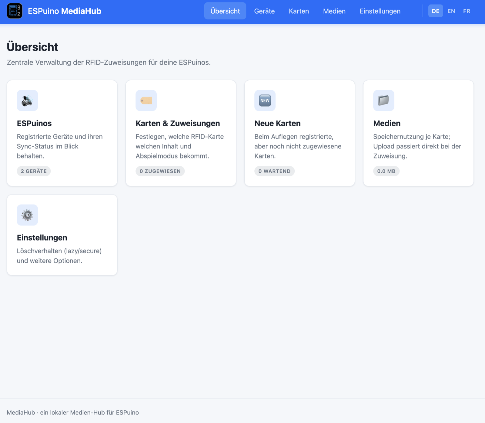
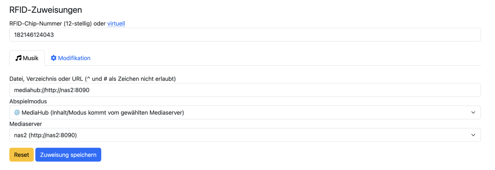
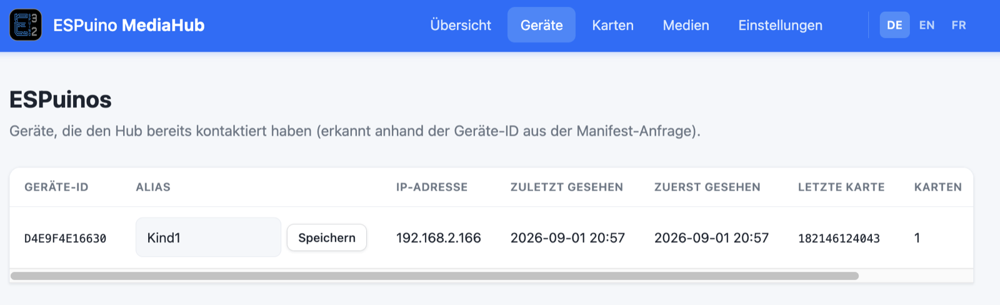
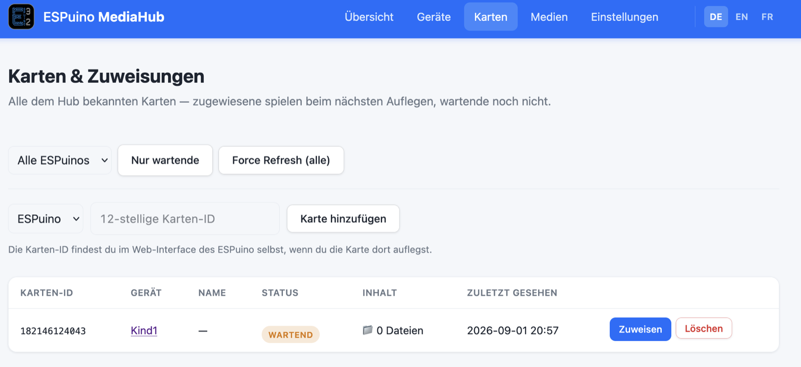
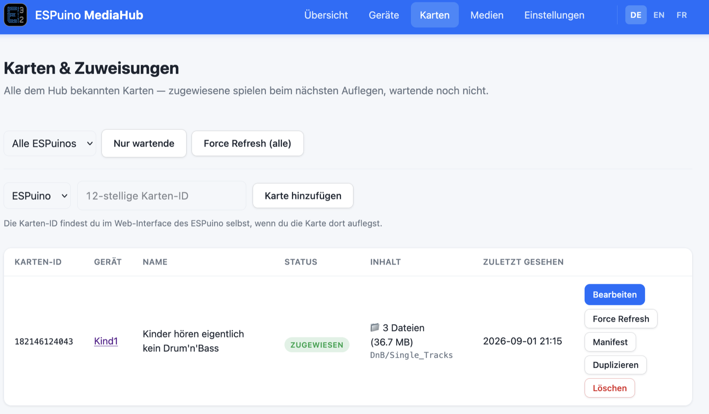
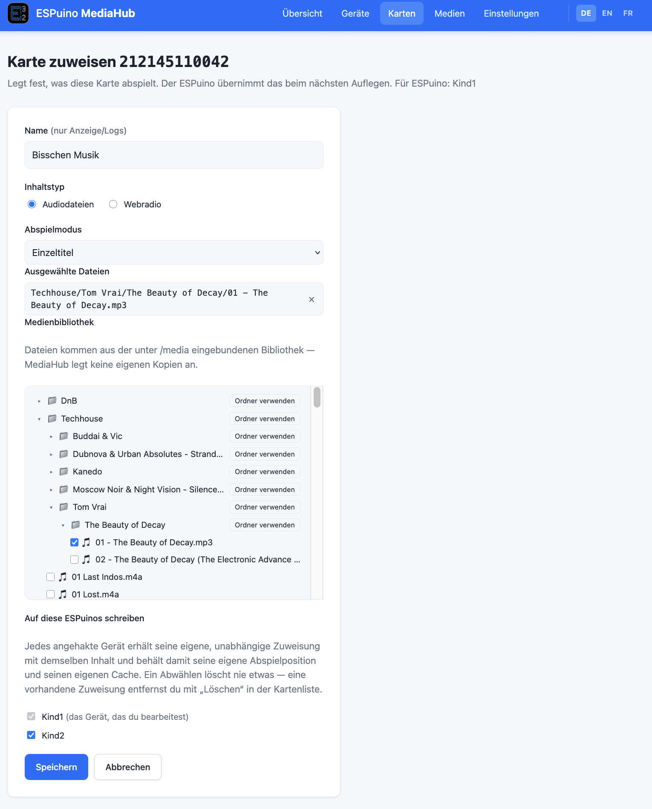
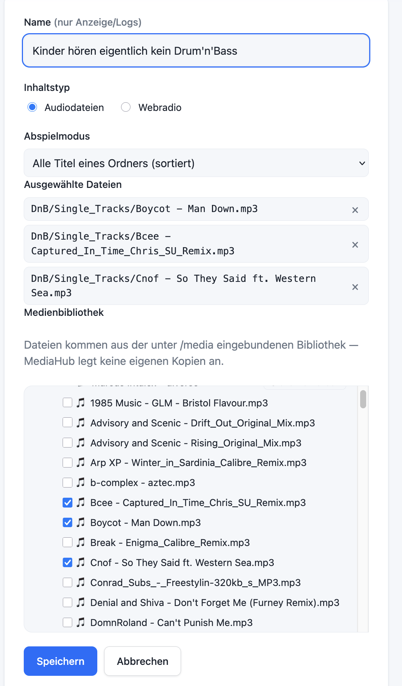
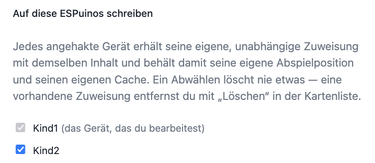
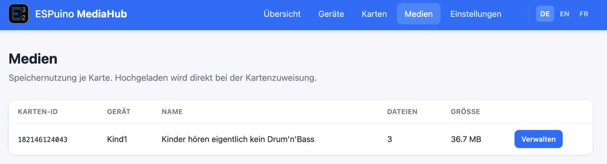
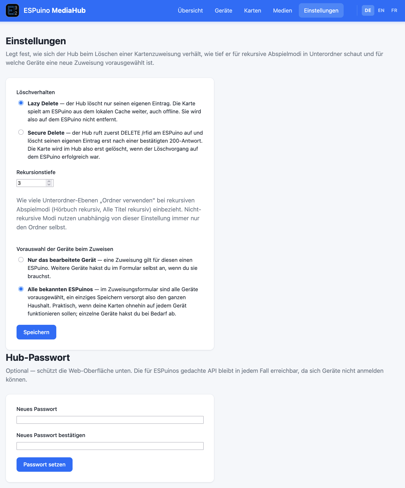

# 11 · Mehrere ESPuinos zentral verwalten: MediaHub


*Die MediaHub-Übersichtsseite: Geräte, Karten & Zuweisungen, neue Karten und Medien auf einen Blick.
Die Oberfläche gibt es auch auf Englisch und Französisch (oben rechts umschaltbar).*

## Welches Problem MediaHub löst

Solange du einen einzigen ESPuino betreibst, ist alles einfach: Du legst deine Kartenzuordnungen im
Webinterface an, und sie liegen im Speicher genau dieses Geräts. Sobald aber mehrere ESPuinos im
Haushalt stehen – im Kinderzimmer, im Wohnzimmer, eines für unterwegs –, wird die Pflege mühsam. Jede
neue Karte müsstest du auf jedem Gerät einzeln anlernen, und die SD-Karten getrennt bestücken.

Genau hier setzt **MediaHub** an. MediaHub ist eine **optionale** Zusatzkomponente, mit der du die
Kartenzuordnungen **zentral** an einer Stelle verwaltest, statt auf jedem Gerät für sich. Wer nur
einen ESPuino hat, für den bringt MediaHub vermutlich wenig Zugewinn. Wer hingegen mehrere
besitzt oder die Anschaffung eines weiteren plant, für den kann es die Verwaltung deutlich
entspannen. Bewusst heißt die Funktion nicht „Cloud": MediaHub läuft **lokal in deinem eigenen
Netzwerk**, deine Mediendateien bleiben bei dir zu Hause.

!!! info "Wo die vollständige Anleitung liegt"
    Dieses Kapitel deckt Einrichtung und Bedienung ausführlich ab. Für Details am Quellcode selbst –
    etwa wenn du an MediaHub mitentwickeln möchtest – bleibt das
    [MediaHub-Repository](https://github.com/biologist79/ESPuino-Mediahub) die Quelle; die
    ausführliche Forums-Diskussion läuft im
    [Forum-Thread #4607](https://forum.espuino.de/t/espuino-mediahub/4607).

## Wie es funktioniert

MediaHub ist ein kleiner, **selbst gehosteter Serverdienst**, der als Docker-Container in deinem
eigenen Netzwerk läuft (ein Raspberry Pi reicht dafür völlig). Er hält die zentralen
Kartenzuordnungen und kennt deine Mediendateien – die liegen unverändert in deiner eigenen
Ordnerstruktur, MediaHub kopiert oder verwaltet sie nicht selbst, sondern bindet sie nur **lesend**
ein.

Der Ablauf besteht aus sechs Schritten:

1. **MediaHub-Server registrieren.** Im ESPuino-Webinterface trägst du im
   [Tab MediaHub](../bedienung/webinterface.md#tab-mediahub) die Adresse deines MediaHub-Servers
   ein. Du kannst mehrere Server registrieren und auch wieder entfernen, ohne dass sich das auf
   bereits angelernte Karten auswirkt.
2. **Karte als „MediaHub" anlernen.** Im [Tab RFID](../bedienung/webinterface.md#tab-rfid) lernst du
   eine neue Karte an – als Abspielmodus wählst du **MediaHub** und darunter den gewünschten
   Mediaserver aus der Liste der registrierten Server. Einen Pfad gibst du dabei nicht an; ESPuino
   weiß nur, an welchen Server er sich wenden soll. Diesen Schritt kannst du dir sparen, wenn du die
   Option
   [„Unbekannte Karten ohne Anlernen direkt beim MediaHub nachfragen"](../bedienung/webinterface.md#mediahub-optionen)
   aktiviert hast – dann genügt das Auflegen selbst.
3. **Erstes Auflegen: Registrierung.** Legst du die Karte zum ersten Mal auf, schickt ESPuino eine
   Anfrage an den MediaHub. Dort taucht die Karte jetzt als „wartend" auf – mit der Karten-ID und
   der Kennung des anfragenden ESPuino, aber noch ohne Inhalt.
4. **Zuweisung am MediaHub.** Im MediaHub-Webinterface verknüpfst du die wartende Karte mit einem
   Inhalt – einer Datei, einem Ordner oder einem Webradio-Stream – und legst den Abspielmodus fest,
   genauso wie du es sonst im ESPuino-Webinterface tätest. Hast du mehrere Geräte, kannst du sie im
   selben Schritt gleich mitversorgen (siehe unten).
5. **Zweites Auflegen: Download.** Beim nächsten Auflegen fragt der ESPuino erneut an und bekommt
   diesmal ein **Manifest** zurück – die Liste aller benötigten Dateien. Er lädt sie herunter und
   legt sie in einem versteckten Verzeichnis auf der eigenen SD-Karte ab. Während des Downloads ist
   die Wiedergabe gesperrt; der Neopixel-Ring zeigt den Fortschritt in Blau.
6. **Wiedergabe.** Sobald der Download fertig ist, startet die Wiedergabe – von da an **lokal von
   der eigenen SD-Karte**, unabhängig vom MediaHub. Änderst du die Zuweisung später am MediaHub,
   bemerkt der ESPuino das von selbst: Beim nächsten Auflegen spielt er noch die alte Fassung,
   vergleicht dabei aber im Hintergrund die Version und merkt sich, dass eine neuere bereitliegt.
   Das übernächste Auflegen lädt sie herunter und spielt noch nicht; erst das darauffolgende spielt
   den neuen Inhalt.

!!! note "Was zentral ist – und was nicht"
    MediaHub nimmt dir das **Auflegen der Karten nicht** ab: Jede Karte musst du weiterhin **einmal
    pro Gerät** auflegen – entweder, um sie dabei wie in Schritt 2 auf MediaHub zu verweisen, oder,
    wenn du die Option
    [„Unbekannte Karten ohne Anlernen direkt beim MediaHub nachfragen"](../bedienung/webinterface.md#mediahub-optionen)
    aktiviert hast, allein durch das Auflegen selbst. Der Grund: Sonst bräuchte
    MediaHub selbst einen eigenen RFID-Reader, um die ID der Karte überhaupt zu kennen. Zentral ist
    nur die **eigentliche Verknüpfung zum Inhalt** – also welche Dateien bzw. welcher Stream und
    welcher Abspielmodus zu einer Karte gehören. Diese Zuordnung pflegst du einmal am MediaHub, und
    alle Geräte ziehen sie von dort.

## MediaHub-Server installieren

Für den Server brauchst du einen Rechner mit **Docker** und dem **Compose-Plugin** – ein Raspberry
Pi reicht völlig.

!!! tip "Noch kein Server – oder noch nie mit Linux gearbeitet?"
    Die Befehle in diesem Abschnitt setzen voraus, dass Docker auf deinem Server schon läuft und du
    ungefähr weißt, was sie tun. Falls nicht, fang stattdessen beim Abschnitt
    [Den Server einrichten – von Grund auf](#server-einrichten) an: Er beginnt beim leeren Gerät,
    erklärt jeden Schritt und endet an derselben Stelle.

MediaHub wird als **fertiges Image** veröffentlicht, und zwar für `amd64`, `arm64` und `arm/v7` –
ein Raspberry Pi 2, ein Pi 5 und ein Intel-NAS sind damit gleichermaßen abgedeckt. Es gibt also
nichts zu kompilieren, und du brauchst auch keine Kopie des Projekts: Zwei Dateien genügen.

```bash
mkdir ESPuino-Mediahub && cd ESPuino-Mediahub
curl -O https://raw.githubusercontent.com/biologist79/ESPuino-Mediahub/main/docker-compose.yml
curl -o .env https://raw.githubusercontent.com/biologist79/ESPuino-Mediahub/main/env-example
docker compose up -d
```

Um den Ordner für die Datenbank musst du dich nicht kümmern: Der Container legt ihn beim ersten
Start an und übergibt ihn seinem eigenen Dienstkonto, bevor er die eigenen Rechte ablegt.

Der Kniff dabei: Deine persönlichen Einstellungen liegen in der Datei `.env`, nicht in der
`docker-compose.yml`. Bearbeite ausschließlich die `.env` – dann kannst du die `docker-compose.yml`
jederzeit durch eine neuere ersetzen, ohne deine Einstellungen zu verlieren.

### Die `.env`-Datei

| Variable | Standard | Bedeutung |
| --- | --- | --- |
| `MEDIAHUB_TAG` | `latest` | Welche Fassung des Images läuft. `latest` folgt dem Entwicklungsstand; ein Wert wie `sha-4a86674` nagelt genau einen Stand fest und ist der Weg zurück, falls eine Änderung Ärger macht. |
| `MEDIAHUB_PORT` | `8080` | Port, unter dem MediaHub erreichbar ist. Ist er belegt, wähle einen anderen. |
| `MEDIAHUB_DATA` | `./data` | Ablageort der MediaHub-Datenbank (`db.json`). Der Ordner braucht Schreibzugriff. |
| `MEDIAHUB_MEDIA` | `./media` | Pfad zu deiner bestehenden Mediensammlung. Wird **read-only** eingebunden – MediaHub legt darin nichts an und verändert nichts. |
| `MEDIAHUB_NAME` | `espuino-mediahub` | Name des Containers, etwa für `docker logs <name>`. Nur nötig, wenn du mehrere MediaHubs auf demselben Gerät betreiben willst. |
| `MEDIAHUB_UID` / `MEDIAHUB_GID` | `33` / `33` | Nutzer- bzw. Gruppen-ID, unter der der Dienst läuft (Standard: `www-data`). Setze sie auf die ID, der deine Mediensammlung gehört, dann erübrigt sich jedes Anpassen von Dateirechten. |
| `TZ` | `Europe/Berlin` | Zeitzone des Containers, etwa für Zeitstempel wie „zuletzt gesehen". |

!!! tip "Dateien sichtbar, aber nicht lesbar?"
    Verzeichnis-Auflistung und Datei-Lesen sind zwei getrennte Unix-Rechte: Ein Titel kann im
    Datei-Baum auftauchen, sich beim Zuweisen aber trotzdem mit „permission denied" weigern, wenn
    die Datei selbst für die MediaHub-UID nicht lesbar ist. Abhilfe schafft entweder
    `chmod -R o+rX /pfad/zu/deiner/bibliothek`, oder du setzt `MEDIAHUB_UID`/`MEDIAHUB_GID` in der
    `.env` auf die UID/GID, der deine Bibliothek ohnehin schon gehört (`id -u` / `id -g`).

Nach dem Start prüfst du mit `docker compose ps`, ob der Container läuft, und rufst MediaHub im
Browser unter `http://<deine-IP>:8080` auf.

!!! warning "HTTPS wird nicht empfohlen"
    Brauchst du unbedingt Verschlüsselung, schalte einen Reverse Proxy davor (etwa Traefik). Für die
    Verbindung **zwischen ESPuino und MediaHub** ist HTTPS dagegen keine gute Idee: Es kostet den
    ohnehin knappen Arbeitsspeicher des ESP32 und senkt den Datendurchsatz spürbar – unverschlüsselt
    sind etwa 650–700 kB/s drin, verschlüsselt deutlich weniger.

## Den Server einrichten – von Grund auf { #server-einrichten }

Der Abschnitt oben setzt voraus, dass auf deinem Server schon Docker läuft und du mit der
Kommandozeile vertraut bist. Falls nicht, holt dich dieser Abschnitt weiter vorne ab. Er führt von
einem brandneuen, noch leeren Raspberry Pi bis zum laufenden MediaHub und erklärt dabei die Begriffe,
auf die es ankommt – und wenn du ein NAS von Synology oder QNAP hast oder woanders schon Docker
betreibst, sagt dir der nächste Abschnitt, welche Schritte du dir sparen kannst. Linux-Vorwissen
brauchst du nicht; ein vollständiger Linux-Kurs ist das hier aber auch nicht. Erklärt wird, was du
für diesen einen Zweck verstehen musst.

Plane eine halbe bis eine Stunde ein, von der ein guter Teil Wartezeit ist: Die Karte wird
beschrieben, das System aktualisiert sich, und das Container-Image wird heruntergeladen. Wenn du
zwischendurch nicht weiterkommst, hilft die [Befehlsübersicht](#docker-befehle) am Ende des
Abschnitts.

### Vielleicht reicht Hardware, die du schon hast

Bevor du etwas anschaffst: Ein Raspberry Pi, der **nur** MediaHub betreibt, ist reichlich
unterfordert. Der Dienst besteht aus einem einzigen Container, der die meiste Zeit gar nichts tut –
er wird erst wach, wenn ein ESPuino eine Karte meldet oder du im Browser etwas änderst.

Genau dafür ist Docker gemacht: Auf einem Gerät können so viele Container nebeneinander laufen, wie
Arbeitsspeicher und Rechenleistung hergeben – jeder mit seinen eigenen Abhängigkeiten und ohne sich
mit den anderen zu streiten. Ein [Pi-hole](https://pi-hole.net/){ target="_blank" rel="noopener" },
[Home Assistant](https://www.home-assistant.io/){ target="_blank" rel="noopener" }, ein
[Paperless-ngx](https://github.com/paperless-ngx/paperless-ngx){ target="_blank" rel="noopener" }, eine
Wetterstation, und MediaHub eben mit dabei. Der Arbeitsspeicher ist dabei die Grenze, an die du
zuerst stößt – auf einem Pi mit 1 GB ist eher früher Schluss als auf einem mit 8 GB. MediaHub selbst
gehört zu den sparsamen Mitbewohnern: ein Python-Prozess mit zwei Arbeitern, der nichts im
Hintergrund berechnet. Und jeder Dienst braucht seinen eigenen Port (bei MediaHub über
`MEDIAHUB_PORT` in der `.env`).

Umgekehrt heißt das: **Läuft bei dir schon irgendwo Docker** – auf einem Pi, einem kleinen Server,
in einer VM –, dann brauchst du von dieser Anleitung nur die Schritte 5 bis 7.

**Und es muss kein Raspberry Pi sein.** Wer ein NAS betreibt, hat die passende Hardware längst im
Haus: ein Gerät, das ohnehin rund um die Uhr läuft und auf dem die Mediensammlung meist schon liegt.
Bei Fertiggeräten ist Docker ein Paket, das du in der Oberfläche nachinstallierst – bei Synology
heißt es „Container Manager", bei QNAP „Container Station", und bei anderen Herstellern ähnlich.
Läuft dein NAS auf etwas Selbstgebautem, zum Beispiel
[OpenMediaVault](https://www.openmediavault.org/){ target="_blank" rel="noopener" },
[Unraid](https://unraid.net/){ target="_blank" rel="noopener" } oder
[TrueNAS](https://www.truenas.com/){ target="_blank" rel="noopener" }, ist Docker entweder schon da
oder als Erweiterung in wenigen Klicks nachgerüstet. In allen diesen Fällen entfallen die Schritte 1
bis 4 komplett: Betriebssystem, SSH-Zugang und Docker-Installation sind dort schon erledigt.

Vier Hinweise dazu:

- MediaHub wird als fertiges Image veröffentlicht, es muss also nichts gebaut werden. Damit reicht
  die Oberfläche des NAS: Dort legst du ein „Projekt" an, fügst die `docker-compose.yml` des
  Projekts ein und startest es. Das Image wird beim ersten Start automatisch geladen.
- Deine Einstellungen aus der `.env` (dazu gleich mehr) kannst du in diesen Oberflächen meist auch
  direkt als Umgebungsvariablen eintragen, statt eine Datei zu pflegen. Beides ist richtig.
- Das Thema Dateirechte aus Schritt 6 bleibt dir auch auf einem NAS nicht erspart. Dort entscheidet
  die Benutzer- und Gruppen-ID, unter der die Freigabe steht, darüber, was der Container lesen darf.
- Kommt die NAS-Oberfläche mit der Compose-Datei nicht zurecht, nimm den Weg über SSH: Docker ist
  auf einem NAS dasselbe Docker, die Befehle aus den Schritten 5 bis 7 gelten unverändert.

### Was du dafür brauchst

Entscheidest du dich für einen Raspberry Pi, kommt Folgendes zusammen:

| Zutat | Anmerkung |
| --- | --- |
| **Raspberry Pi 2 oder neuer** | MediaHub ist so anspruchslos, dass selbst ein alter Pi 2 genügt. Beachte nur: Die 64-Bit-Systeme sind erst ab Pi 3 freigegeben – auf einem Pi 2 nimmst du in Schritt 1 die 32-Bit-Variante, für die es das MediaHub-Image ebenfalls gibt. |
| **Original-Netzteil** | Die häufigste Ursache für scheinbar defekte Raspberry Pis sind zu schwache Handy-Ladegeräte. |
| **microSD-Karte, 16 GB** | System und Container-Image brauchen zusammen nur wenige Gigabyte. Wer den Pi dauerhaft laufen lässt, fährt mit einer SSD am USB-Port langlebiger – SD-Karten sterben irgendwann an den vielen Schreibzugriffen. Soll es trotzdem eine Karte sein, nimm ein auf Dauerschreiben ausgelegtes Modell: Die werden als „High Endurance" oder „Pro Endurance" verkauft, eigentlich für Dashcams und Überwachungskameras, und halten ein Vielfaches aus. |
| **Netzwerk** | Per Netzwerkleitung oder WLAN. Für einen Server, der Audiodateien ausliefert, ist die erste Option im Zweifel die stabilere Wahl. |
| **Ein Rechner** | Damit schreibst du die Karte und steuerst den Pi anschließend fern. |

Monitor, Tastatur und Maus brauchst du **am Pi nicht**. Er wird vom ersten Moment an über das
Netzwerk bedient – das ist für einen Server, der später irgendwo in einer Ecke steht, auch der
Normalfall.

### Was Docker eigentlich ist

MediaHub ist ein Python-Programm und braucht einige Bausteine in bestimmten Versionen: Python selbst,
das Web-Framework Flask, einen Webserver und ein paar Bibliotheken mehr. Diese Dinge auf einem Pi
von Hand einzurichten ist möglich, aber mühsam – und bei jedem Update musst du nachziehen.

Genau dafür gibt es Docker. Die Idee: Nicht du richtest die Umgebung ein, sondern eine Textdatei im
Projekt (das `Dockerfile`) beschreibt sie – „nimm Python 3.12, installiere diese Pakete, starte
dieses Programm". Diese Beschreibung wird einmal abgearbeitet, und das Ergebnis ist ein **Image**:
eine fertige, unveränderliche Vorlage. Bei MediaHub passiert das nicht auf deinem Gerät, sondern
automatisch bei GitHub, nach jeder Änderung am Projekt. Das Ergebnis liegt in einer **Registry** –
einem Lager für Images, in diesem Fall dem von GitHub selbst. Du lädst es von dort nur noch herunter.

Startest du ein Image, entsteht daraus ein **Container** – salopp gesagt ein abgeschotteter
Mini-Rechner, der genau dieses eine Programm enthält und sonst nichts. Anders als eine virtuelle
Maschine bringt er aber kein eigenes Betriebssystem mit, sondern benutzt den Kern des Pi mit.
Deshalb kostet er kaum Ressourcen und startet in Sekunden.

Für dich sind daran drei Dinge wichtig:

- **Der Container ist ein Wegwerfobjekt.** Du kannst ihn jederzeit löschen und neu erzeugen, und
  genau das passiert bei jedem Update. Verloren geht dabei nichts, solange die Daten außerhalb
  liegen – siehe nächster Punkt.
- **Was überleben soll, liegt in einem Volume.** Ein Volume ist ein Ordner des Pi, der in den
  Container hineingereicht wird. MediaHub benutzt zwei davon: `data` (die Datenbank, beschreibbar)
  und `media` (deine Mediensammlung, nur lesbar hineingereicht). Alles andere im Container ist
  flüchtig.
- **Der Container sieht nur, was du hineinreichst.** Das ist ein Sicherheitsgewinn, sorgt aber auch
  für die häufigste Stolperfalle überhaupt: Ein Pfad, den du nicht als Volume angegeben hast,
  existiert für MediaHub nicht – auch wenn er auf dem Pi einwandfrei da ist.

Bliebe noch **Compose**. Ein Container braucht beim Start eine Menge Angaben: welches Image, welcher
Port, welche Volumes, unter welchem Benutzer, was bei einem Neustart passieren soll. Statt dir das
alles als endlos lange Befehlszeile zuzumuten, steht es bei MediaHub in der Datei
`docker-compose.yml`. Der Befehl `docker compose` liest sie und setzt um, was dort steht. Du tippst
also immer nur kurze Befehle, und die Konfiguration bleibt nachlesbar in einer Datei.

!!! note "`docker compose` oder `docker-compose`?"
    Compose gab es früher als separates Programm, das mit Bindestrich aufgerufen wurde
    (`docker-compose up`). Heute ist es ein **Plugin** und damit ein Unterbefehl von Docker selbst,
    ohne Bindestrich (`docker compose up`). Ältere Anleitungen im Netz benutzen noch die alte
    Schreibweise. Wenn du die hier aufgeführten Befehle verwendest, bist du auf der richtigen Seite.

### Schritt 1 · Das Betriebssystem auf die Karte schreiben

Lade dir den [Raspberry Pi Imager](https://www.raspberrypi.com/software/) herunter – es gibt ihn für
Windows, macOS und Linux. Er lädt das Betriebssystem herunter und schreibt es auf die SD-Karte.

Wie das im Einzelnen abläuft, zeigen die offizielle
[Dokumentation](https://www.raspberrypi.com/documentation/computers/getting-started.html) und
unzählige Videos besser, als ein Handbuchkapitel es könnte. Wichtig sind für uns nur zwei
Entscheidungen:

**Das richtige Betriebssystem.** Wähle unter „Raspberry Pi OS (other)" die Variante **Raspberry Pi OS
Lite (64-bit)**. „Lite" heißt: ohne grafische Oberfläche. Das ist kein Verzicht, sondern für einen
Server erwünscht – was nicht installiert ist, braucht keinen Arbeitsspeicher und will nicht
aktualisiert werden. Bedient wird der Pi ohnehin über die Kommandozeile. Auf einem Pi 2 oder einem
noch älteren Modell wählst du stattdessen **Raspberry Pi OS Lite (32-bit)**: Die 64-Bit-Images sind
erst ab Pi 3 freigegeben, Docker läuft auf der 32-Bit-Variante genauso.

**Die Voreinstellungen vor dem Schreiben.** Der Imager fragt, ob er die Installation anpassen soll.
Sag ja und fülle aus:

- **Hostname** – zum Beispiel `mediahub`. Der Pi ist damit im Heimnetz meist als `mediahub.local`
  erreichbar, und du musst dir keine IP-Adresse merken.
- **Benutzername und Passwort** – frei wählbar. Ein voreingestellter Benutzer `pi` mit dem Passwort
  `raspberry` existiert seit einigen Jahren nicht mehr; ohne diese Angabe käme der Pi beim ersten
  Start nicht hoch.
- **WLAN** samt Land, falls du keine Netzwerkleitung benutzt.
- **SSH aktivieren**, mit Passwort-Anmeldung.

Diese Angaben werden direkt mit auf die Karte geschrieben. Dadurch hängt sich der Pi beim allerersten
Start selbst ins Netzwerk und lässt sich sofort fernsteuern – ohne SSH-Häkchen bliebe er stumm und du
bräuchtest doch einen Monitor.

Danach: Karte in den Pi, Netzwerkleitung dran, Strom dran. Der erste Start dauert ein bis zwei
Minuten, weil das Dateisystem auf die Kartengröße aufgezogen wird.

!!! tip "Feste Adresse im Router eintragen"
    Jeder ESPuino speichert später die **Adresse** seines MediaHubs. Bekommt der Pi vom Router bei
    irgendeinem Neustart eine andere IP-Adresse, finden deine Geräte ihn nicht mehr. Reserviere ihm
    deshalb in den Router-Einstellungen eine feste IP-Adresse (meist „DHCP-Reservierung" oder
    „Immer dieselbe IPv4-Adresse zuweisen"). Das ist fünf Minuten Arbeit, die dir später eine
    verwirrende Fehlersuche erspart.

### Schritt 2 · Die erste Verbindung per SSH

**SSH** ist eine verschlüsselte Fernsteuerung für die Kommandozeile: Du tippst auf deinem Rechner,
ausgeführt wird alles auf dem Pi. Öffne dazu ein Terminal – unter macOS die „Terminal"-App, unter
Windows die PowerShell oder das Windows Terminal, unter Linux dein gewohntes Terminal – und gib ein
(mit deinem Benutzernamen und deinem Hostnamen):

```bash
ssh benutzername@mediahub.local
```

Bei der allerersten Verbindung fragt SSH, ob du dem Gerät vertraust, und zeigt einen „Fingerprint"
an. Bestätige mit `yes`. Danach wirst du nach dem Passwort gefragt. Dass dabei **nichts** erscheint –
nicht einmal Sternchen – ist normal und kein Fehler; tippe einfach weiter und drücke Enter.

Begrüßt dich eine Zeile wie `benutzername@mediahub:~ $`, bist du drin. Das `~` steht für dein
persönliches Verzeichnis, in dem du als normaler Benutzer schreiben darfst; dort legen wir MediaHub
gleich ab. Mit `exit` kannst du die Sitzung jederzeit beenden.

!!! tip "`mediahub.local` funktioniert nicht?"
    Die Auflösung von `.local`-Namen funktioniert nicht in jedem Netz und nicht auf jedem Rechner
    zuverlässig. Sieh in diesem Fall in der Geräteliste deines Routers nach, welche IP-Adresse der Pi
    bekommen hat, und verbinde dich damit: `ssh benutzername@192.168.1.50`.

Ein Begriff, der ab jetzt ständig auftaucht: **`sudo`**. Als normaler Benutzer darfst du das System
absichtlich nicht verändern. `sudo` („superuser do") stellst du einem einzelnen Befehl voran, um ihn
mit Administratorrechten auszuführen; gelegentlich wird dabei dein Passwort abgefragt. Der
Administrator heißt unter Linux übrigens **`root`** und trägt die Benutzer-ID 0 – ihm ist alles
erlaubt, und genau deshalb arbeitet man nicht dauerhaft als er. Alles, was am System selbst etwas
ändert – Pakete installieren, Eigentümer von Ordnern umschreiben – braucht `sudo`. Alles andere läuft
bewusst ohne.

### Schritt 3 · Das System aktualisieren

Raspberry Pi OS verwaltet seine Software über **apt** – eine Art App Store für die Kommandozeile, der
Programme aus geprüften Paketquellen installiert und aktuell hält. Starte mit:

```bash
sudo apt update
sudo apt full-upgrade -y
```

Der erste Befehl holt nur die aktuellen Paketlisten („was gibt es inzwischen?"), der zweite
installiert die Aktualisierungen dann tatsächlich. Das `-y` beantwortet Rückfragen vorab mit Ja.
Mehr brauchst du hier nicht zu installieren: MediaHub selbst kommt als fertiges Image, und das
Werkzeug zum Herunterladen (`curl`) ist im Lite-Image schon enthalten.

Wenn beim Upgrade ein neuer Systemkern dabei war, starte den Pi einmal neu und verbinde dich danach
wieder per SSH:

```bash
sudo reboot
```

### Schritt 4 · Docker installieren

Docker stellt für die Installation ein offizielles Skript bereit, das die Paketquelle einrichtet und
alle nötigen Teile installiert:

```bash
curl -fsSL https://get.docker.com -o get-docker.sh
sudo sh get-docker.sh
```

Die erste Zeile lädt das Skript herunter (`curl` ist ein Kommandozeilen-Downloader), die zweite führt
es aus. Danach sind Docker selbst, sein Kommandozeilen-Werkzeug, der Dienst im Hintergrund und die
Plugins **buildx** und **compose** installiert – `docker compose` steht also ohne weitere
Installation bereit.

!!! note "Warum nicht einfach `apt install docker.io`?"
    Weil dieses Paket das Compose-Plugin nicht mitbringt, MediaHub aber genau damit gestartet wird.
    Und ja: Das Skript oben lädt eine Datei aus dem Netz und führt sie mit Administratorrechten aus.
    Es ist das offizielle von Docker, und für einen Heim-Server ist das der übliche Weg. Wer es
    genauer nehmen will, richtet die Paketquelle nach der
    [Docker-Dokumentation](https://docs.docker.com/engine/install/debian/) von Hand ein – das
    Ergebnis ist dasselbe.

Damit du nicht jedem Docker-Befehl ein `sudo` voranstellen musst, trägst du dich noch in die
Gruppe `docker` ein:

```bash
sudo usermod -aG docker $USER
```

Wer in dieser Gruppe ist, darf Docker steuern – und damit faktisch alles auf dem Gerät. Für einen
Heim-Server ist das der übliche Umgang; auf einer Maschine mit mehreren Nutzern würdest du genauer
hinsehen. Die Gruppenmitgliedschaft wird außerdem erst bei einer **neuen Anmeldung** wirksam. Beende
die Sitzung deshalb mit `exit` und verbinde dich erneut per SSH. Danach prüfst du, ob alles da ist:

```bash
docker --version
docker compose version
```

Beide Befehle sollten eine Versionsnummer ausgeben. Tun sie das, ist die Grundlage fertig.

### Schritt 5 · MediaHub herunterladen und einstellen

Das Programm selbst musst du nicht herunterladen – es steckt im fertigen Image, das Docker sich im
nächsten Schritt von allein holt. Was du brauchst, sind nur zwei kleine Textdateien: die
Beschreibung des Dienstes und deine eigenen Einstellungen. Leg dir dafür einen Ordner an:

```bash
mkdir ~/ESPuino-Mediahub
cd ~/ESPuino-Mediahub
curl -O https://raw.githubusercontent.com/biologist79/ESPuino-Mediahub/main/docker-compose.yml
curl -o .env https://raw.githubusercontent.com/biologist79/ESPuino-Mediahub/main/env-example
```

`mkdir` erzeugt den Ordner, `cd` („change directory") wechselt hinein, und `curl` lädt die beiden
Dateien aus dem Projekt herunter – die zweite gleich unter ihrem neuen Namen `.env` (der führende
Punkt macht sie unter Linux zu einer versteckten Datei; `ls -a` zeigt sie trotzdem).
**Alle folgenden Befehle gehören in diesen Ordner**, denn `docker compose` sucht die
`docker-compose.yml` immer im aktuellen Verzeichnis. Wenn du später einmal unsicher bist, wo du
gelandet bist: `pwd` verrät es, und `cd ~/ESPuino-Mediahub` bringt dich zurück.

Jetzt deine Einstellungen:

```bash
nano .env
```

`nano` ist ein einfacher Texteditor fürs Terminal: Mit den Pfeiltasten bewegst du den Cursor, mit
**Strg+O** und Enter speicherst du, mit **Strg+X** verlässt du den Editor.

Welche Werte dort hineingehören, steht in der [Tabelle weiter oben](#die-env-datei). Für den Anfang
reichen meist zwei: `MEDIAHUB_MEDIA` auf deine Mediensammlung zeigen lassen und, falls Port 8080 auf
dem Pi schon belegt ist, einen anderen `MEDIAHUB_PORT` eintragen.

!!! warning "Nur die `.env` bearbeiten"
    Es ist verlockend, die Werte direkt in `docker-compose.yml` zu ändern – tu es nicht. Diese Datei
    gehört zum Projekt und wird bei jedem Update überschrieben bzw. erzeugt Konflikte. Die `.env`
    dagegen ignoriert git, sie ist deine und bleibt unangetastet.

### Schritt 6 · Mediensammlung einbinden und Dateirechte klären

Bis hierher war jeder Schritt für jeden gleich. Ab hier wird es individuell: Wo deine Hörspiele,
Hörbücher und Musik liegen, auf welchem Datenträger und Dateisystem, und wem die Dateien gehören –
das sieht in jedem Haushalt anders aus. Für diesen Schritt gibt es deshalb kein Rezept zum Abtippen,
und es ist gleichzeitig die Stelle, an der Linux-Neulinge am häufigsten hängen bleiben. Darum bekommt
sie einen eigenen Schritt und etwas mehr Erklärung als die anderen.

Zu beantworten sind nämlich nur zwei Fragen, und die bleiben immer dieselben, wie dein Aufbau auch
aussieht: **Sieht der Pi deine Sammlung überhaupt als Ordner?** Und: **Darf der Benutzer, unter dem
MediaHub läuft, diese Dateien lesen?** Die folgenden Absätze gehen die häufigsten Fälle durch. Ist
deiner nicht genau dabei, lass dich davon nicht beirren – die beiden Fragen sind trotzdem die
richtigen, es unterscheidet sich nur der Weg zur Antwort.

!!! note "Für Umsteiger von Windows: keine Laufwerksbuchstaben"
    Unter Linux gibt es kein `C:` und kein `D:`. Es existiert genau **ein** Verzeichnisbaum, der bei
    `/` beginnt, und alles andere hängt irgendwo darin. Ein USB-Datenträger bekommt deshalb keinen
    Buchstaben, sondern wird an eine Stelle dieses Baums eingehängt – üblicherweise unterhalb von
    `/mnt` oder `/media`. `/mnt/medien` ist also kein Laufwerk, sondern ein ganz normaler Ordner, der
    den Inhalt des Datenträgers zeigt, solange dieser eingebunden ist. Zwei Kleinigkeiten noch, die
    unter Windows anders sind: Pfade trennt der Schrägstrich `/` und nicht der Backslash, und Groß-
    und Kleinschreibung ist bedeutsam – `Hoerspiele` und `hoerspiele` sind zwei verschiedene Ordner.

**Zuerst: Wo liegt deine Sammlung?** MediaHub kann nur lesen, was auf dem Pi als Ordner vorhanden
ist. Liegt sie auf einem USB-Datenträger am Pi, muss dieser dauerhaft eingebunden („gemountet")
sein – Raspberry Pi OS Lite macht das ohne Desktop nicht von allein. `lsblk -f` zeigt dir die
angeschlossenen Datenträger samt UUID; mit dieser UUID trägst du den Datenträger in
`/etc/fstab` ein, damit er bei jedem Start automatisch an derselben Stelle auftaucht.

Ein Wort zu dieser Datei, weil der Rest des Schritts an ihr hängt: `/etc/fstab` („file systems
table") ist die Liste der Datenträger, die das System beim Hochfahren einbinden soll. Eine Zeile je
Datenträger, und jede nennt vier Dinge – was eingebunden wird (hier über die UUID, denn Gerätenamen
wie `/dev/sda1` können sich beim nächsten Start verschieben), wohin im Verzeichnisbaum, mit welchem
Dateisystem und mit welchen Optionen.

Einbinden geht auch ohne diese Datei: Ein `sudo mount /dev/sda1 /mnt/medien` wirkt sofort. Nach dem
nächsten Neustart ist es aber wieder weg – und dann zeigt MediaHub eine leere Bibliothek, ohne dass
irgendetwas kaputt wäre. Was dauerhaft gelten soll, gehört deshalb in die `fstab`:

```bash
sudo mkdir -p /mnt/medien
sudo nano /etc/fstab
```

Eine Zeile wie diese am Ende der Datei genügt (UUID und Dateisystem natürlich an deinen Datenträger
anpassen):

```
UUID=1234-ABCD  /mnt/medien  exfat  defaults,nofail,ro,uid=33,gid=33,umask=022  0  0
```

Das `nofail` ist wichtig: Ohne diese Option bleibt der Pi beim Start hängen, wenn der Datenträger
einmal nicht angeschlossen ist. Die Optionen `uid`, `gid` und `umask` bestimmen, wem die Dateien auf
diesem Datenträger gehören sollen – was dahintersteckt, erklärt der Absatz zu den Dateirechten
gleich im Anschluss. Sie wirken nur bei Dateisystemen ohne eigene Rechteverwaltung, also exFAT,
FAT32, NTFS und Netzwerkfreigaben. Ist dein Datenträger
mit **ext4** formatiert, lass sie weg (sonst verweigert der Befehl den Dienst); dort gelten die
Rechte, die im Dateisystem selbst gespeichert sind – siehe den übernächsten Absatz.

Damit die neue Zeile sofort gilt, musst du nicht neu starten: `sudo mount -a` arbeitet die `fstab`
auf der Stelle ab und bindet alles ein, was dort steht und noch nicht eingebunden ist – genau wie es
beim Hochfahren geschieht. Das macht den Befehl auch zur besten Probe: Läuft er ohne Murren durch,
klappt es beim nächsten Start ebenso; stört er sich an deiner Zeile, erfährst du es jetzt und nicht
erst beim nächsten Neustart. Soll es nur dieser eine Eintrag sein, genügt `sudo mount /mnt/medien`.
Ob es geklappt hat, zeigt dir `ls /mnt/medien`. Anschließend setzt du `MEDIAHUB_MEDIA=/mnt/medien` in
der `.env`.

Liegt die Sammlung auf einem **NAS** oder einer Netzwerkfreigabe, ist der Weg derselbe, nur mit
`cifs-utils` (`sudo apt install -y cifs-utils`) und einer `//server/freigabe`-Zeile in der `fstab`.
Beachte dabei: Bei Netzwerkfreigaben entscheiden die **Mount-Optionen** über die Rechte, nicht die
Rechte auf dem NAS – `uid=33,gid=33` in der fstab-Zeile erspart dir den ganzen nächsten Absatz.

**Und jetzt die Dateirechte.** Dafür lohnt sich ein kurzer Blick darauf, wie Linux Benutzer
überhaupt auseinanderhält – das ist eines der Dinge, die man einmal verstanden haben sollte, weil
danach vieles einleuchtet.

Linux kennt seine Benutzer nämlich nicht an ihrem Namen, sondern an einer **Nummer**: der
Benutzer-ID, kurz **uid**. Dasselbe gilt für Gruppen, da heißt sie Gruppen-ID oder **gid**. Namen wie
`pi` oder `www-data` sind nur Beschriftungen, die das System in einer Tabelle nachschlägt;
gespeichert und geprüft wird immer die Zahl. Ein paar davon sind fest vergeben: `0` ist `root`, die
Nummern unter 1000 gehören Dienstkonten – `33` ist `www-data`, das Konto, unter dem Webdienste
üblicherweise laufen –, und der erste Benutzer, den du bei der Installation angelegt hast, hat
gewöhnlich die `1000`. Deine eigenen Nummern verrät `id`, einzeln `id -u` und `id -g`.

Jede Datei und jeder Ordner trägt nun genau zwei dieser Nummern, nämlich die uid des Eigentümers und
die gid der Gruppe. Dazu kommen die Zugriffsrechte, und die sind dreifach vergeben: für den
Eigentümer, für die Gruppe und für alle anderen, jeweils getrennt nach Lesen, Schreiben und
Ausführen. Mit `ls -l` siehst du das – dort stehen die Namen; `ls -ln` zeigt stattdessen die
Nummern, was manchmal aufschlussreicher ist.

Entscheidend ist nun: Der MediaHub-Dienst läuft **nicht** als Administrator, sondern standardmäßig
unter der Benutzer-ID `33`. Das ist bewusst so – ein Dienst am Netz soll nicht mehr Rechte haben, als
er braucht. Dass dabei von der Nummer und nicht von einem Benutzernamen die Rede ist, hat denselben
Grund wie oben: Im Container heißt die 33 `www-data`, auf deinem Pi vielleicht gar nichts oder etwas
ganz anderes – verglichen wird die Zahl. Für dich heißt das: Nicht deine Rechte entscheiden darüber,
was MediaHub lesen kann, sondern die der ID 33.

Um seinen eigenen Datenordner kümmert sich der Container dabei selbst: Er startet kurz mit
Administratorrechten, überschreibt den Eigentümer von `data` und gibt die Rechte dann ab. Dieser
Schritt entfällt für dich also.

Deine Mediensammlung dagegen lässt er unangetastet – sie muss für die ID 33 **lesbar** sein, und hier
lauert die eigentliche Falle: Einen Ordner auflisten und eine Datei lesen sind unter Linux zwei
verschiedene Rechte. Es kann also passieren, dass ein Titel im Datei-Browser von MediaHub brav
auftaucht, das Zuweisen aber mit „permission denied" scheitert. Dann hilft eines von beidem:

```bash
chmod -R o+rX /mnt/medien
```

… womit alle anderen („**o**thers") die Dateien lesen (`r`) und in Ordner hineinwechseln dürfen. Das
große `X` ist dabei kein Tippfehler, sondern der Trick: Es setzt das Ausführungsrecht nur für
Verzeichnisse und macht nicht aus jeder MP3-Datei ein Programm. Alternativ lässt du den Container
unter der ID laufen, der deine Sammlung sowieso gehört – `id -u` und `id -g` zeigen deine eigene an,
die du dann als `MEDIAHUB_UID` und `MEDIAHUB_GID` in die `.env` einträgst. Beides ist in Ordnung;
nimm den Weg, der dir weniger Arbeit macht.

### Schritt 7 · Starten und nachsehen

Jetzt der große Moment:

```bash
docker compose up -d
```

Zwei Dinge passieren hier: `up` lädt beim ersten Mal das Image herunter – rund 55 MB, je nach
Anbindung also eine Sache von Sekunden bis wenigen Minuten – und startet daraus den Container. Das
`-d` schickt ihn in den Hintergrund, und das ist wichtig: Dadurch läuft MediaHub weiter, auch wenn du
die SSH-Sitzung beendest und dein Rechner ausgeht.

Ob er läuft, verrät:

```bash
docker compose ps
```

Steht dort ein Status wie `Up` oder `running`, öffne MediaHub im Browser – unter
`http://mediahub.local:8080` beziehungsweise unter der IP-Adresse des Pi mit dem Port aus deiner
`.env`. Wie es im MediaHub-Webinterface weitergeht, beschreibt der Abschnitt
[Das MediaHub-Webinterface](#das-mediahub-webinterface).

Um den automatischen Start nach einem Stromausfall musst du dich übrigens nicht kümmern: In der
`docker-compose.yml` steht `restart: unless-stopped`. Docker startet den Container nach einem
Neustart des Pi also von selbst wieder – es sei denn, du hast ihn ausdrücklich selbst gestoppt.

### Die wichtigsten Befehle für den Alltag { #docker-befehle }

Alle diese Befehle führst du in dem Ordner aus, in dem deine `docker-compose.yml` liegt – nach
dieser Anleitung also in `~/ESPuino-Mediahub`:

| Befehl | Wirkung |
| --- | --- |
| `docker compose ps` | Läuft der Container? Zeigt Status und Port. |
| `docker compose logs -f` | Liest das Protokoll mit – die erste Anlaufstelle, wenn etwas nicht funktioniert. **Strg+C** beendet das Mitlesen, nicht den Container. |
| `docker compose restart` | Container neu starten. |
| `docker compose stop` / `docker compose start` | Anhalten und wieder anfahren, etwa für eine Datensicherung. |
| `docker compose pull` dann `docker compose up -d` | Das Update: neues Image holen, Container damit ersetzen. |
| `docker compose down` | Container entfernen. Deine Daten im Ordner `data` bleiben erhalten. |
| `docker images` | Listet die vorhandenen Images mit Tag und Größe – so siehst du, welche `sha-`-Fassungen noch herumliegen. |
| `docker image rm <name:tag>` | Löscht ein bestimmtes Image, etwa die Fassung von vorletzter Woche. Benutzt ein Container es noch, weigert sich Docker – dann vorher `docker compose down`. |
| `docker system prune -f` | Räumt alte, nicht mehr benutzte Images auf – nach mehreren Updates macht das auf einer kleinen SD-Karte spürbar Platz frei. Betrifft alle Container auf dem Pi, nicht nur MediaHub. |

!!! tip "Erste Hilfe, wenn es nicht läuft"
    Startet der Container nicht oder bleibt die Seite im Browser leer, liefert `docker compose logs`
    fast immer die Antwort im Klartext. Typische Fälle: ein belegter Port (dann einen anderen
    `MEDIAHUB_PORT` in die `.env` eintragen), ein `MEDIAHUB_MEDIA`-Pfad, der auf dem Pi gar nicht
    existiert – dann startet MediaHub zwar, zeigt aber eine leere Bibliothek –, oder eine Meldung,
    dass der Datenordner nicht beschreibbar ist. Letztere nennt den Befehl, der das behebt, gleich
    mit; sie tritt nur auf, wenn der Ordner auf einer Freigabe liegt, deren Rechte sich auch von
    innen nicht ändern lassen. Kommst du nicht weiter, frag im
    [ESPuino-Forum](https://forum.espuino.de) und häng die Ausgabe von `docker compose logs` an.

## Aktualisieren

```bash
docker compose pull
docker compose up -d
```

`pull` holt das aktuelle Image, `up -d` ersetzt den laufenden Container damit – das ist das ganze
Update. Dein Ordner `data` und deine `.env` bleiben unangetastet, es gibt also nichts zu sichern und
nichts zu übertragen.

Welche Fassung du bekommst, entscheidet `MEDIAHUB_TAG` in deiner `.env`. Standard ist `latest`, und
`latest` zeigt immer auf den aktuellen Entwicklungsstand – dasselbe also, was du früher mit
`git pull` bekommen hast. Macht eine Änderung bei dir Ärger, trägst du stattdessen einen der
`sha-…`-Tags von der
[Paketseite](https://github.com/biologist79/ESPuino-Mediahub/pkgs/container/espuino-mediahub) ein
und bist nach einem erneuten `pull` wieder auf dem alten Stand. Das ist der bequemste Teil der
Umstellung auf fertige Images: Zurückrollen heißt eine Zeile ändern.

Zwei Dinge lohnen nach einem Update den Blick: Neue Optionen tauchen zuerst in `env-example` auf und
müssen von Hand in deine `.env` übernommen werden, und gelegentlich ändert sich die
`docker-compose.yml` selbst – dann lädst du sie mit demselben `curl`-Befehl wie bei der Installation
erneut herunter.

!!! note "docker-compose.yml nicht direkt ändern"
    Brauchst du Erweiterungen, die sich nicht über die `.env` abbilden lassen, leg dir eine eigene
    `docker-compose.override.yml` daneben. Compose liest sie automatisch mit, und deine Anpassungen
    überleben so jedes Ersetzen der `docker-compose.yml`.

!!! tip "Lieber selbst bauen?"
    Wer das Image aus dem Quellcode bauen will – zum Entwickeln, zum Ausprobieren einer eigenen
    Änderung oder für eine Plattform, die das fertige Image nicht abdeckt – klont das Projekt und
    nimmt die mitgelieferte Zusatzdatei dazu:
    `docker compose -f docker-compose.yml -f docker-compose.build.yml up -d --build`.

Je nachdem, was sich an der Zusammenarbeit mit ESPuino geändert hat, kann zusätzlich ein
[Firmware-Update](../firmware/aktualisieren.md) auf den Geräten selbst sinnvoll sein.

## Datensicherung

Der Docker-Container selbst ist ein Wegwerfobjekt – er lässt sich jederzeit neu erzeugen. Was zählt,
ist allein der Ordner `data`: Ohne dessen Inhalt (die Datenbank-Datei `db.json`) sind alle
MediaHub-Konfigurationen, registrierten ESPuinos und Kartenzuweisungen verloren. Sichere diesen
Ordner deshalb regelmäßig, am besten außerhalb des Servers.

!!! warning "Datenbank nicht von Hand bearbeiten"
    Die `db.json` sollte nicht manuell editiert werden. Musst du dennoch einmal direkt daran
    arbeiten, stoppe vorher den Container mit `docker compose stop`.

## MediaHub im ESPuino-Webinterface

Am ESPuino selbst betrifft dich MediaHub an zwei Stellen: der [Tab
MediaHub](../bedienung/webinterface.md#tab-mediahub), um Server zu registrieren, und der [Tab
RFID](../bedienung/webinterface.md#tab-rfid), um eine Karte tatsächlich einem Server zuzuweisen.
Welche Karten dieses Geräts bereits auf einen Mediaserver zeigen und wie aktuell ihre lokale Kopie
ist, verrät dir die
[Liste der gespeicherten Zuweisungen](../bedienung/webinterface.md#zuweisungsliste) im Tab Tools.



Wählst du beim Anlernen einer Karte den Abspielmodus **MediaHub**, erscheint darunter ein weiteres
Dropdown **Mediaserver** mit allen registrierten Servern. Das Feld „Datei, Verzeichnis oder URL"
füllt sich dabei automatisch – als Kombination aus dem Präfix `mediahub://` und der Server-Adresse,
etwa `mediahub://http://nas2:8090`. Das trägst du nicht selbst ein, es ist reine interne
Buchführung: So weiß ESPuino beim nächsten Auflegen, an welchen Server er sich wenden muss.

!!! tip "Das Anlernen kannst du dir auch sparen"
    Aktivierst du im Tab MediaHub die Option
    [„Unbekannte Karten ohne Anlernen direkt beim MediaHub nachfragen"](../bedienung/webinterface.md#mediahub-optionen),
    entfällt dieser Schritt ganz: Legst du eine Karte auf, die der ESPuino nicht kennt, fragt er
    von sich aus bei den registrierten Servern nach und übernimmt eine dort hinterlegte Zuweisung
    automatisch. Das lohnt sich vor allem bei mehreren Geräten – sonst müsstest du jede Karte auf
    jedem Gerät einzeln anlernen.

## Das MediaHub-Webinterface

Die Weboberfläche des MediaHub-Servers selbst gliedert sich in fünf Bereiche: **ESPuinos**, **Karten
& Zuweisungen**, **Neue Karten** (ein Filter auf noch unzugewiesene Karten), **Medien** und
**Einstellungen** – alle über die Navigation oben erreichbar.

### Geräte



Hier listet MediaHub alle ESPuinos, die sich bereits gemeldet haben – erkannt anhand der Geräte-ID
aus der Manifest-Anfrage. Zu jedem Gerät siehst du die IP-Adresse, wann es zuletzt und zuerst
gesehen wurde, welche Karte zuletzt aufgelegt wurde und wie viele Karten diesem Gerät bereits
zugeordnet sind. Der voreingestellte Anzeigename ist die technische Geräte-ID; über das Textfeld
daneben vergibst du stattdessen einen **Alias** wie „Kind1", der dir überall sonst in der Oberfläche
angezeigt wird.

### Karten & Zuweisungen



Diese Seite listet alle Karten, die dem MediaHub bekannt sind – zugewiesene spielen beim nächsten
Auflegen, wartende noch nicht. Über die Filter oben schränkst du auf ein bestimmtes ESPuino-Gerät
ein, blendest mit **„Nur wartende"** unzugewiesene Karten ein, oder stößt mit **„Force Refresh
(alle)"** für sämtliche Karten einen erneuten Download an. Kennst du die zwölfstellige Karten-ID
bereits (zu finden im ESPuino-Webinterface selbst, sobald du die Karte dort auflegst), kannst du
eine Karte auch ganz ohne vorheriges Auflegen manuell hinzufügen.

Wartende Karten entstehen übrigens auch dann, wenn ein ESPuino mit der oben genannten Option nach
einer ihm unbekannten Karte fragt und kein Server sie kennt. Das Auflegen einer neuen Karte meldet
sie also hier an, noch bevor sie irgendwo zugewiesen ist.

Die Liste hält sich dabei selbst aktuell: Legst du eine Karte auf, während diese Seite offen ist,
erscheint sie nach wenigen Sekunden von allein – neu laden musst du nichts. Tippst du in diesem
Moment gerade eine Karten-ID ein oder hast ein Dialogfenster offen, wird dir die Seite nicht unter
den Händen weggezogen; stattdessen erscheint oben ein Streifen mit dem Knopf **„Jetzt
aktualisieren"**.



Ist eine Karte zugewiesen, stehen dir pro Zeile fünf Aktionen zur Verfügung:

| Aktion | Wirkung |
| --- | --- |
| **Bearbeiten** | Ändert die Zuweisung nachträglich. Wurden die Daten bereits auf den ESPuino übertragen, holt er sich die neue Fassung von selbst – wie in Schritt 6 oben beschrieben, über die nächsten Auflegevorgänge. |
| **Force Refresh** | Erzwingt einen erneuten Download, obwohl sich am Inhalt nichts geändert hat – gedacht für den Fall, dass die lokale Kopie auf dem ESPuino beschädigt ist oder fehlt. |
| **Manifest** | Zeigt die Download-Datei, die der ESPuino für diese Karte bekommt. |
| **Duplizieren** | Kopiert eine fertige Zuweisung nachträglich auf ein weiteres Gerät – etwa, wenn ein ESPuino erst später dazukommt. Beim Anlegen und Bearbeiten gehst du stattdessen direkt über die Geräte-Häkchen im Formular (siehe unten). |
| **Löschen** | Entfernt die Zuordnung (beachte dabei die Lösch-Einstellung, siehe unten). |

!!! warning "Datei ausgetauscht? Zuweisung neu speichern"
    Ersetzt du eine Datei in deiner Bibliothek durch eine neue Fassung, ohne die Zuweisung im
    Formular erneut zu speichern, hilft auch ein „Force Refresh" nicht weiter: Der ESPuino prüft
    jede geladene Datei gegen Größe und Prüfsumme aus dem Manifest, und die kennt MediaHub noch vom
    alten Stand. Der Download scheitert an dieser Prüfung, und es bleibt bei der alten Kopie. Öffne
    in so einem Fall die Zuweisung einmal und speichere sie erneut – dabei liest MediaHub Größe und
    Prüfsumme frisch ein, und der ESPuino holt sich die neue Fassung von allein.

#### Das Zuweisungs-Formular



Beim Zuweisen füllst du folgende Felder aus:

- **Name** – nur zur eigenen Orientierung, taucht in der Liste und in Logs auf, hat aber keine
  Funktion für die Wiedergabe.
- **Inhaltstyp** – entweder **Audiodateien** aus deiner Bibliothek oder ein **Webradio**-Stream
  (eine lokale `.m3u`-Liste unterstützt MediaHub nicht).
- **Abspielmodus** – dieselbe Liste wie im ESPuino-Webinterface (siehe
  [Kapitel 8 → Die Abspielmodi](../bedienung/webinterface.md#abspielmodi)).
- **Medienbibliothek** – ein Ordnerbaum deiner unter `MEDIAHUB_MEDIA` eingebundenen Sammlung. Über
  „Ordner verwenden" übernimmst du einen ganzen Ordner für Modi wie „Alle Titel eines Ordners".
- **Auf diese ESPuinos schreiben** – alle übrigen bekannten Geräte als Häkchen. Jedes angehakte
  Gerät erhält dieselbe Zuweisung, so dass eine Karte mit einem einzigen Speichern auf mehreren
  ESPuinos landet. Der Block erscheint nur, wenn überhaupt ein zweites Gerät bekannt ist.

!!! tip "Auch einzelne Dateien statt eines ganzen Ordners"
    Bei ordnerbasierten Modi wie „Alle Titel eines Ordners (sortiert)" musst du nicht zwingend den
    kompletten Ordner übernehmen: Du kannst im Baum auch **einzelne Dateien anhaken** – nur diese
    werden dann übertragen, nicht der Rest des Ordners. Praktisch, wenn eine Karte nur eine Auswahl
    aus einer größeren Sammlung abdecken soll.



!!! note "Mehrere Geräte, mehrere Einträge"
    Jedes angehakte Gerät bekommt eine **eigene** Zuweisung mit demselben Inhalt, keinen gemeinsamen
    Eintrag für alle. Das ist Absicht: So behält jeder ESPuino bei Hörbüchern seine eigene
    Abspielposition und seinen eigenen Download-Cache. Trägt ein Gerät die Karte schon, ist sein
    Häkchen von vornherein gesetzt – damit eine nachträgliche Änderung am Inhalt nicht nur auf einem
    Gerät ankommt und die Einträge auseinanderlaufen. Das Gerät, dessen Karte du gerade bearbeitest,
    ist immer angehakt und lässt sich nicht abwählen.

    **Ein Abwählen löscht nichts.** Ein leeres Häkchen heißt „dieses Gerät nicht anfassen", nicht
    „Zuweisung dort entfernen" – zum Löschen nimmst du **„Löschen"** in der Kartenliste. Der Grund:
    Löschen kann je nach Einstellung den ESPuino selbst kontaktieren, und das soll nicht als
    Nebenwirkung eines Speichern-Knopfs passieren.



### Medien



Diese Seite zeigt, wie viele Dateien und wie viel Speicherplatz zu jeder Karte gehören. Einen
eigenen Upload-Bereich gibt es bewusst nicht – hochgeladen wird nicht auf dieser Seite, sondern
direkt bei der Kartenzuweisung, indem du Dateien aus deiner bestehenden Bibliothek auswählst.

### Einstellungen



Hier legst du fest, wie sich MediaHub beim Löschen einer Kartenzuweisung verhält, wie tief er bei
rekursiven Abspielmodi in Unterordner schaut und für welche Geräte eine neue Zuweisung vorausgewählt
ist:

- **Löschverhalten** – **Lazy Delete** (Standard) löscht nur den Eintrag im MediaHub; die Karte
  spielt am ESPuino unverändert aus dem lokalen Cache weiter, auch offline, und wird dort nicht
  entfernt. **Secure Delete** ruft dagegen zuerst die Lösch-Funktion am ESPuino selbst auf und
  entfernt den Eintrag im MediaHub erst, nachdem das Gerät den Löschvorgang bestätigt hat – dafür
  muss der ESPuino zu diesem Zeitpunkt erreichbar sein.
- **Rekursionstiefe** (Standard: 3) – legt fest, wie viele Unterordner-Ebenen rekursive Abspielmodi
  wie „Hörbuch rekursiv" oder „Alle Titel rekursiv" beim Download einbeziehen. Nicht-rekursive Modi
  nutzen unabhängig davon immer nur den gewählten Ordner selbst. Setze den Wert nicht unnötig hoch –
  sonst kann eine einzelne Zuweisung ungewollt viele Daten nach sich ziehen.
- **Vorauswahl der Geräte beim Zuweisen** – bestimmt nur, welche Häkchen das Zuweisungs-Formular
  von vornherein mitbringt. **Nur das bearbeitete Gerät** (Standard) verhält sich wie bisher; **Alle
  bekannten ESPuinos** hakt jedes Gerät gleich an, so dass ein einziges Speichern den ganzen
  Haushalt versorgt. Geschrieben wird in beiden Fällen nur, was beim Speichern tatsächlich angehakt
  ist.
- **Hub-Passwort** (optional) – schützt nur die **Weboberfläche** von MediaHub selbst. Die
  API-Schnittstelle, über die sich die ESPuinos melden, bleibt davon unberührt erreichbar, da Geräte
  sich nicht anmelden können.

## Weiterführend

- [ESPuino-Mediahub auf GitHub](https://github.com/biologist79/ESPuino-Mediahub) – Quellcode und
  technische Spezifikation.
- [Forum-Thread #4607](https://forum.espuino.de/t/espuino-mediahub/4607) – Vorstellung und
  Diskussion.
